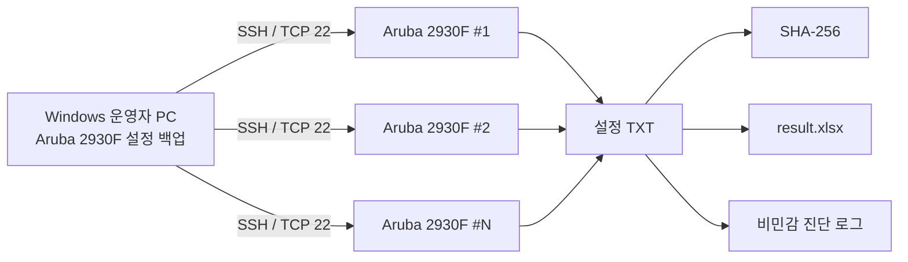
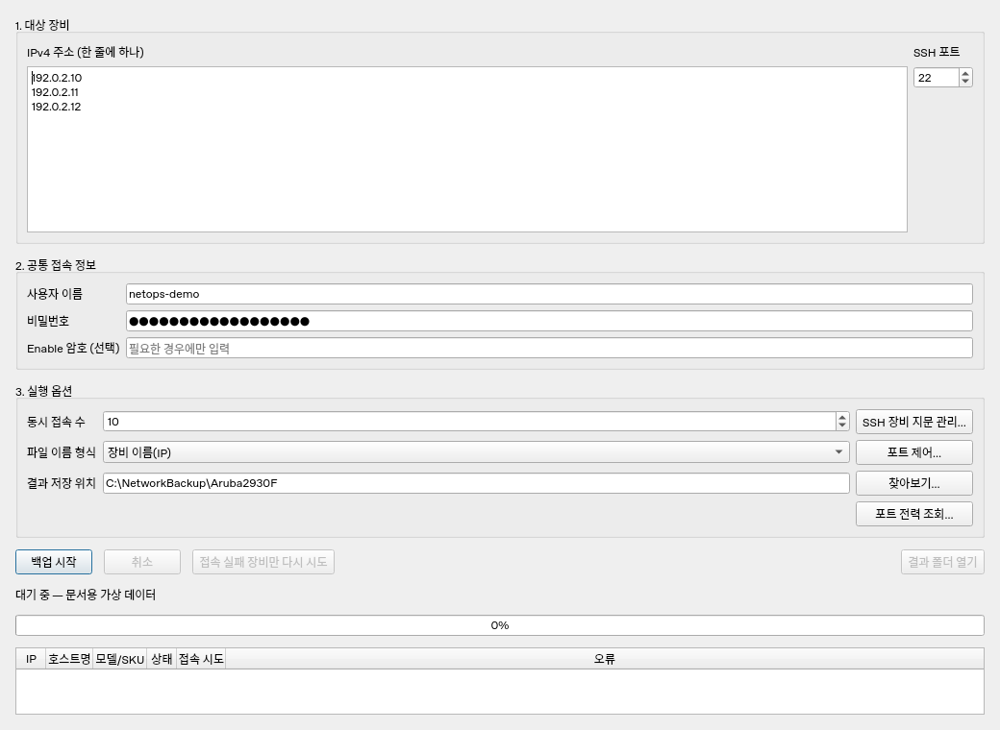
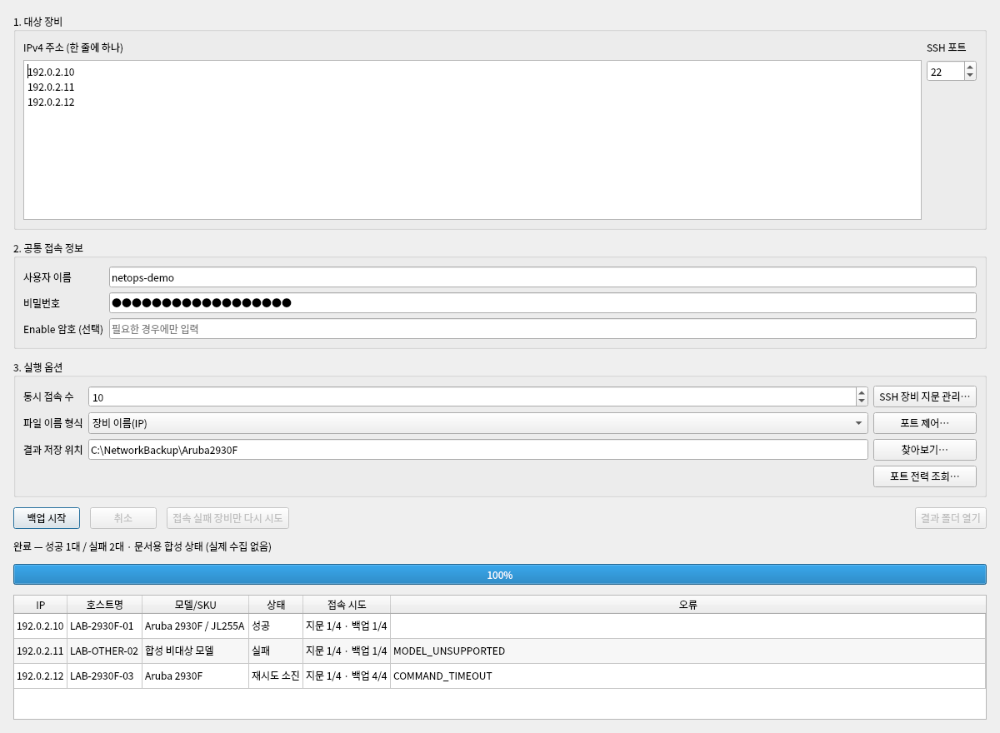

# Aruba 2930F 네트워크 통합 관리

[](https://github.com/sebia1993/aruba-2930f-config-backup/actions/workflows/ci.yml)
[](LICENSE)

## 브라우저에서 사용하는 로컬 웹

Windows x64용 ZIP을 풀고 **Start-Local-Web.cmd**를 실행하세요. 첫 화면인 **포트·PoE 관리**에서 조회하면 매트릭스가 열립니다. 포트를 선택해 PoE 전원을 제어하거나 **결과 목록**으로 전환해 스위치별 전력과 AP 이름을 비교할 수 있습니다. **모니터링 시작**을 누르면 입력한 전체 포트의 전력과 LLDP AP 이름을 1~60분 간격으로 확인할 수 있습니다. **변화만 보기**로 직전 조회와 비교하거나 **우선 확인**으로 전력을 점검할 포트를 고를 수 있습니다. **케이블 진단**을 열면 포트·PoE 관리에서 고른 스위치와 포트의 진단 결과를 조회하거나 새 검사를 실행할 수 있습니다. 서버 PC에서 **네트워크 공유**를 켜면 다른 PC나 휴대폰의 브라우저에 `서버IP:18766`을 입력해 접속할 수 있습니다. 공유를 끄면 원격 연결이 종료됩니다. [로컬 웹 사용 안내](local-web/README.md) · [웹 v1.12.0 다운로드](https://github.com/sebia1993/aruba-2930f-config-backup/releases/tag/web-v1.12.0)

## Windows 데스크톱 프로그램

**ArubaOS-Switch 기반 Aruba 2930F의 컨피그 백업과 포트별 LLDP·PoE 상태 조회 및 안전한 포트 제어를 하나의 Windows 프로그램에서 처리합니다.** 메인 메뉴는 홈 / 컨피그 백업 / 포트 통합 관리 / 작업 이력의 4개만 제공합니다. 별도 설정 페이지 없이 백업 화면에서 저장 경로를 정하며, SSH 지문 검증·최초 승인 및 변경 차단은 유지합니다.

> **v0.3.0에서는 스위치 IP·포트 목록을 입력해 포트별 전력, LLDP AP 이름, AP-535 공급 판정을 함께 조회합니다.** 결과는 IP·실제 호스트네임으로 묶고 대상 목록을 저장·불러오기 할 수 있습니다. [전력·LLDP 조회 안내](docs/POE_QUERY_KO.md)에서 판정 근거와 사용법을 확인하십시오. v0.2.0의 [단일 포트 제어](docs/PORT_CONTROL_KO.md)도 계속 제공합니다.

> **v0.6.0 기능:** [포트 작업 편의 개선](docs/PORT_OPERATOR_FLOW_KO.md) — 엑셀 IP/포트 2열 붙여넣기 미리보기, 스위치별·필터별 전체 선택, AP-535 대상의 수동 승인형 PoE OFF → 재조회 → ON → 복구 확인 마법사를 추가했습니다. 자동 OFF→ON이나 결과 불확실 포트의 자동 재실행은 지원하지 않습니다.

반복적인 장비 접속과 수동 설정 백업을 줄이고, **장비 식별 → 안전한 CLI 수집 → 실패 격리 → 결과 무결성 확인 → 보고서 생성**을 하나의 운영 절차로 묶는 것을 목표로 합니다.

> **현재 main 코드 버전: [v0.9.5](https://github.com/sebia1993/aruba-2930f-config-backup/releases/tag/v0.9.5)** (`Aruba2930FConfigBackup_v0.9.5_windows_x64.zip`)입니다. WC.16.01.0008 장비의 SSH 서버키 협상 호환성을 자동으로 처리하며, 레거시 예외 승인 버튼 없이 조회할 수 있습니다. GitHub에는 Windows 11용 사전 릴리스를 유지합니다. 현장에서 구형 장비 SSH 로그인은 확인됐으며, 실제 PoE 동작은 장비별로 별도 검증이 필요합니다.

> **WC.16.01 자동 SSH 호환:** 기존처럼 `전체 조회`만 실행하세요. 프로그램이 강한 SSH 방식으로 먼저 연결하고, 서버 호스트키 불일치가 확인된 경우 **인증 전 1회** `ssh-rsa` 서버키 방식으로 재협상합니다. 별도 예외 승인 버튼이나 추가 호환 설정은 없습니다. 포트 결과의 `레거시 SSH` 표시로 구분하며, **최초 SSH 지문 신뢰 승인과 변경된 키 차단은 그대로 유지**합니다. [보안 제약과 상세 절차](docs/SSH_LEGACY_COMPAT_KO.md).

> 새 일괄 제어 기능은 여러 AP의 무선 서비스에 영향을 줄 수 있습니다. 실제 운영 장비 검증은 사용자 직접 수행 범위입니다. 컨피그 수집/포트 제어의 SSH 인증·장비 지문·작업 이력 보호는 그대로 유지합니다.

> **v0.7.0 B안:** 포트 체크박스·스위치 전체 체크로 작업 대상을 지정하고, 하단 고정 바에서 PoE OFF/ON/재가동을 선택합니다. 빠른 전원 제어는 별도 계획 버튼·EXECUTE N 없이 내부 계획을 생성한 뒤 바로 시작합니다(다중 포트 OFF만 취소 가능한 확인 1회). 빠른 실행에서 반복적인 10포트 재승인창은 생략하지만 매 포트 사전 확인·이력 기록·불확실 결과 중단은 유지합니다. 행 클릭은 상세 확인 전용이며 선택 목록에 조회 누락·차단 대상이 있으면 임의로 제외하지 않고 작업을 차단합니다. 검색 후 숨긴 체크 대상도 작업 승인 목록에 포함됩니다. v0.7.0으로 출시됐으며, 이후 UI 표시는 v0.8.0 브랜치에서 개선 중입니다.

> **사용성 추가 개선:** 포트 통합 관리에서는 기존 계획·승인 관련 복잡한 컨트롤을 기본 접어 둡니다. `고급 제어`를 펼칠 때만 단일 포트·포트 Up/Down·기존 계획이 표시됩니다. 하단 빠른 전력 제어에서 작업 중지·상태/진행률을 바로 확인하고, 백업 화면에서 입력한 동일 세션의 SSH 정보를 비어 있는 포트 입력란에 재사용합니다. 최초 미등록 SSH 서버 지문 확인과 스위치 계정 권한 자체는 유지합니다.

> **v0.8.0 SSH 공통 계정 A안:** 통합 앱 상단의 `SSH 계정 설정…`에서 사용자 이름·비밀번호·Enable 암호를 한 번 설정하면 백업·포트 조회·PoE OFF/ON·고급 단일 제어가 같은 실행 세션을 사용합니다. 반복 입력은 필요 없고, 저장은 메모리에만 이루어집니다. 계정이 없으면 처음 SSH 작업 시 설정창이 열립니다. 계정 변경/해제는 작업 중 차단하며 이전 포트 조회 결과는 무효화합니다. 독립 실행 구 GUI는 호환성 때문에 기존 입력 방식을 유지합니다. [SSH 공통 계정 상세](docs/SSH_SESSION_KO.md).

> **v0.8.0 전체 너비 화면:** 포트 통합 관리의 `선택 포트 상세` 우측 패널은 화면에서 제거했습니다. 결과 테이블이 가로 전체 너비를 사용하고, 상세 원인은 포트 상태/PoE 상태 툴팁과 CSV에서 확인할 수 있습니다. 기존 고급 포트 제어 기능은 결과 테이블 아래 접힌 영역으로 이동하고 일반 제어 버튼은 PoE OFF/ON 2개만 보입니다.

> **v0.8.0 전원 버튼 정리:** 포트 통합 관리에서는 PoE OFF 즉시와 PoE ON 즉시 두 버튼만 사용자에게 표시합니다. 중복된 재가동 버튼은 기본 화면과 고급 화면에서 숨기며, OFF와 ON은 별도로 실행합니다. 기존 전원 변경 안전 검증과 실행 이력은 그대로 유지합니다.

> **v0.8.0 A안 화면 개선:** 포트 통합 관리 대상 입력을 펼친 상태로 시작하며, 상하 분할선으로 입력/조회 결과 높이를 조절할 수 있습니다. 입력을 접으면 가로폭 전체의 조회 결과가 확대됩니다. 엑셀 붙여넣기 창(1120×750)은 원본/검증 미리보기를 좌우 분할로 표시하고 모든 대상 스위치를 확인합니다. 'PoE 판정' 및 '조회 상태' 열은 '포트 상태(Enable/Disable · Link Up/Down)'와 'PoE 상태(Power Enable 및 실제 공급)'로 바꾸고 상세 근거는 CSV에 유지합니다.

## 포트폴리오 요약

| 채용 관점 | 내용 |
|---|---|
| 해결한 문제 | 여러 스위치에 반복 접속해 설정을 백업하고 결과를 수작업으로 정리하던 과정을 하나의 Windows 도구로 표준화 |
| 담당 범위 | 문제 정의, Windows GUI, SSH 안전 경계, 장비 식별, 결과 무결성, 패키징, 테스트와 CI/CD |
| 핵심 판단 | 빠른 수집보다 **잘못된 장비·바뀐 SSH 지문·불완전한 출력에서 멈추는 것**을 우선 |
| 검증 증거 | 단위·루프백 SSH·오프라인 GUI 테스트, Windows CI, ZIP·SHA-256·CycloneDX SBOM 검증. 버전별 결과는 [개발 기록](DEVELOPMENT_LOG.md)과 GitHub Actions에서 확인 |
| 증거의 한계 | 자동 테스트와 합성 SSH 검증 결과이며, 실제 운영 장비·업무 성과 수치로 해석하지 않음 |

## 채용 검토자를 위한 읽는 순서

[포트폴리오 검토 안내](docs/PORTFOLIO_REVIEW_KO.md)에서 **설계 질문 → 실제 코드 → 실패 사례 테스트 → 장비 없는 재현 → 검증 한계** 순서로 확인할 수 있습니다. 아래 운영 설명과 함께 읽으면 기능 주장과 공개 근거를 대조할 수 있습니다.

## 한눈에 보기

| 항목 | 내용 |
|---|---|
| 대상 장비 | Aruba 2930F / 2930F VSF |
| 네트워크 OS | ArubaOS-Switch |
| 접속 방식 | SSH, 기본 TCP 22 |
| 수집 명령 | `show running-config` |
| 장비 변경 | 백업은 변경 없음. 별도 포트 제어에서 대상 확인 후 PoE/포트 사용 설정 변경 |
| 사전 확인 | SSH 장비 지문, EXEC 프롬프트, `no page`, 모델/SKU |
| 백업 동시 처리 | 기본 10대, 최대 20대 |
| 백업 실패 처리 | 장비 단위 격리, 5/15/30초 지연 재시도 |
| 백업 결과 | 장비별 TXT, SHA-256, `result.xlsx`, 비민감 진단 로그 |
| 포트 제어 | 단일 포트, 변경 명령 자동 재전송 없음, 대상·전후 상태를 담는 별도 작업 이력 |
| 포트 전력·LLDP 조회 | 스위치별 묶음, 포트별 W와 AP 이름, AP-535 공급·협상 근거, 최대 3대 동시 접속 |
| 실행 환경 | Windows x64, Python 설치 불필요한 배포 ZIP |

## 해결하려 한 운영 문제

여러 대의 액세스 스위치 설정을 사람이 직접 백업하면 다음 문제가 반복될 수 있습니다.

- 장비마다 접속해 동일한 명령을 반복해야 함
- 페이지 출력 때문에 설정 일부가 누락될 수 있음
- 잘못된 장비에 접속했는지 사람이 직접 판단해야 함
- 일부 장비의 일시적인 SSH 장애가 전체 작업 흐름을 방해할 수 있음
- 수집 파일과 성공/실패 결과를 별도로 정리해야 함
- 저장된 설정 파일이 온전한지 확인할 근거가 부족함

이 프로젝트는 단순히 SSH 명령을 반복하는 것이 아니라, **운영 과정에서 발생할 수 있는 실패와 오인 가능성까지 함께 제어하는 것**을 설계 목표로 삼았습니다.

## 핵심 설계 판단

| 운영 문제 | 설계 판단 |
|---|---|
| 페이지 출력으로 설정 누락 가능 | 모든 연결에서 `no page`를 먼저 적용하고 정상 응답을 확인한 뒤 `show` 명령 실행 |
| 다른 장비에 잘못 접속할 가능성 | `show version` + `show modules`의 증거를 함께 확인한 뒤 2930F 계열에서만 설정 수집 |
| SSH 대상 장비가 바뀌었을 가능성 | 최초 SSH 장비 지문을 운영자가 검토하고, 승인된 지문이 변경되면 연결 차단 |
| 특정 장비 실패가 전체 작업에 영향 | 장비별 상태와 실패를 격리하고 제한된 동시 처리 적용 |
| 일시적인 통신 장애 | 즉시 반복 대신 5초 → 15초 → 30초 지연 재시도 |
| 인증/모델 오류 같은 영구 실패 | 동일 조건을 반복하지 않고 즉시 종료 |
| 백업 파일의 무결성 확인 | 장비별 설정 파일 저장 후 SHA-256 계산 |
| 운영망 변경 위험 | 백업의 읽기 전용 흐름 유지. 포트 제어는 단일 대상 확인·별도 세션·변경 후 재조회 |
| 문제 재현 시 민감정보 노출 위험 | IP·계정·암호·설정 원문을 포함하지 않는 오류 분류와 오프라인 진단 코드 사용 |

설계 배경과 구성요소별 책임은 [프로그램 구조](docs/ARCHITECTURE.md)에 더 자세히 정리되어 있습니다.

## 동작 구조



장비 한 대에 대한 수집 순서는 다음과 같습니다.

```text
SSH 장비 지문 확인
        ↓
EXEC 프롬프트 확인
        ↓
no page 적용 및 검증
        ↓
show version
show modules
        ↓
Aruba 2930F / VSF 식별
        ↓
show running-config
        ↓
최종 프롬프트·출력 검증
        ↓
TXT 저장 + SHA-256 + Excel 결과 기록
```

## 실행 화면

[화면별 사용 흐름](docs/USAGE_SCREENSHOTS_KO.md)에서 백업 입력 → SSH 지문 확인 → 완료·실패 해석과 다중 포트 전력 조회 화면을 확인할 수 있습니다. 앱 위젯에 합성 상태를 넣어 Qt offscreen으로 렌더링했으며 실제 장비 수집 결과가 아닙니다. 캡처 환경·소스 SHA·도구는 가이드에 기록했습니다.

아래 이미지는 **문서용 가상 IP와 가상 장비명만 사용해 프로그램 자체에서 생성한 예시 화면**입니다. 실제 운영망 주소, 계정, 설정 정보는 포함하지 않습니다.

### 작업 입력 화면



### 수집 완료 예시



## 지원 및 검증 범위

### 지원 범위

| 구분 | 상태 | 비고 |
|---|---|---|
| Aruba 2930F | 지원 | 모델/SKU 확인 후 설정 수집 |
| Aruba 2930F VSF | 지원 로직 | 복수 공식 SKU가 확인되는 구성 포함 |
| ArubaOS-Switch | 지원 대상 | 장비별 OS 차이는 현장 검증 필요 |
| SSH 암호 인증 | 지원 | 공통 계정 사용 |
| Enable 암호 | 선택 지원 | 필요한 환경에서만 사용 |
| IPv4 | 지원 | 현재 입력 대상 |
| Windows x64 | 지원 | 배포 ZIP 기준 |
| 다른 Aruba 모델 | 미지원 | 2930F 외 장비는 차단 |
| 단일 포트 PoE/통신 제어 | v0.2.0부터 제공 | 별도 제어 창에서 대상 확인 후 실행 |
| 다중 스위치·포트 전력 조회 | v0.3.0 구현 | 지정 포트 W·LLDP·AP-535 공급 판정·대상 목록 재사용·CSV |
| 설정 복원 및 그 밖의 구성 변경 | 미지원 | 백업 경로는 읽기 전용 |

### 검증 현황

| 검증 항목 | 상태 |
|---|---|
| 단위 테스트 | ✅ 자동 검증 |
| 가상/루프백 SSH 장비 | ✅ 자동 검증 |
| RSA/SHA-1 서버키를 사용하는 구형 장비의 제한적 자동 협상 및 지문 인증 | ✅ 루프백 자동 검증 |
| Windows 패키지 실행 점검 | ✅ 자동 검증 |
| 릴리즈 ZIP SHA-256 검증 | ✅ 자동 검증 |
| SBOM 생성 및 검증 | ✅ 자동 검증 |
| 문서용 UI 렌더링 | ✅ CI 검증 |
| 실제 Aruba 2930F 운영 장비 | ⚠️ 현장 검증 기록 필요 |
| 대규모 운영망 장시간 검증 | ⚠️ 현장 검증 기록 필요 |

자동 검증과 실제 장비 검증을 구분해 기록합니다. 실제 장비 테스트 항목, 합격 기준, 공개 가능한 증거 형식은 [VALIDATION_REPORT.md](docs/VALIDATION_REPORT.md)에 정의했습니다.

## 빠른 시작

1. GitHub **Releases**에서 `Aruba2930FConfigBackup_v0.9.5_windows_x64.zip`을 받습니다. `main`의 애플리케이션 버전도 v0.9.5입니다.
   아직 게시되지 않은 개발 버전은 해당 PR의 성공한 Windows CI 실행에서
   `Aruba2930FConfigBackup-windows-x64-ci` 아티팩트를 내려받습니다.
2. 함께 제공되는 `.sha256` 파일로 ZIP 해시를 확인합니다.

```powershell
Get-FileHash .\Aruba2930FConfigBackup_v0.9.5_windows_x64.zip -Algorithm SHA256
Get-Content .\Aruba2930FConfigBackup_v0.9.5_windows_x64.zip.sha256
```

3. ZIP 전체를 쓰기 가능한 로컬 폴더에 압축 해제합니다.
4. `Aruba2930FConfigBackup\Aruba2930FConfigBackup.exe`를 실행합니다.
5. 장비 IP, SSH 계정, 동시 접속 수를 입력한 뒤 **백업 시작**을 누릅니다.
6. 처음 보는 장비의 SSH 장비 지문은 실제 관리 정보와 대조한 뒤 승인합니다.
7. 완료 후 장비별 TXT와 `result.xlsx`를 확인합니다.

> EXE만 ZIP에서 따로 꺼내 실행하지 마십시오. 현재 사전릴리즈는 Authenticode 서명이 없어 Windows SmartScreen 경고가 표시될 수 있습니다.

## 여러 스위치·포트의 전력 조회

메인 화면의 **포트 전력 조회…**에서 **스위치 IP·인터페이스 목록 두 칸**을 입력합니다.
예를 들어 A 스위치에는 `12,24`, B 스위치에는 `3,7,10`을 지정하면 각 스위치에서
등록된 포트만 조회합니다. SSH는 기본 22이며 고급 설정에서 비기본 포트와 별칭을
다룹니다. 기존 목록의 값은 유지하고 같은 IP의 다른 SSH 접속 포트는 별도 묶음으로 구분합니다.

1. **스위치 추가** 또는 **엑셀 붙여넣기**로 대상을 등록합니다.
2. 공통 SSH 계정·암호와 필요한 Enable 암호를 입력합니다.
3. **전체 조회**를 누르고 처음 접속하는 스위치의 SSH 지문을 확인합니다.
4. **IP · 실제 호스트네임** 묶음을 펼쳐 포트의 현재 W, LLDP AP 이름과 공급 판정을 확인합니다.
   포트 행을 선택하면 요청·할당 전력, 모델 확인 근거와 PoE·LLDP 각각의 시각을 볼 수 있습니다.
5. **목록 저장 / 목록 불러오기**로 IP·포트 구성을 재사용하고 **CSV 저장**으로 결과를 남깁니다.

목록 파일에는 계정·암호를 저장하지 않습니다. 최대 3대 동시 접속, 한 스위치 안에서는
순차 조회입니다. 먼저 PoE 값을 표시하고 같은 연결에서 LLDP를 추가합니다. LLDP가
실패해도 이미 얻은 전력값은 유지합니다. 전력 합계는 표시하지 않으며 값 누락·미지원·
실패를 실제 0 W와 구분합니다. 수동 재조회와 중지를 지원합니다.

AP-535 판정은 제조사의 지원 전원 조건과 유효한 요청·할당 근거를 사용합니다.
낮은 실제 W만으로 전력 부족을 판정하지 않습니다. `공급·협상 정상`은 해당 포트의
전원 협상 결과이며 AP 전체 서비스 정상이라는 뜻은 아닙니다. 공식 자료와 상세
입력 형식은 [POE_QUERY_KO.md](docs/POE_QUERY_KO.md)에 있습니다.

## 포트 제어

메인 화면의 **포트 제어…**를 누르고 SW IP와 인터페이스 번호를 입력합니다.
일반 스위치는 `24`, VSF는 `1/24`처럼 장비가 사용하는 번호를 그대로 입력합니다.

| 버튼 | 동작 |
|---|---|
| PoE 전원 끄기 / 켜기 | 해당 포트에서 연결 기기에 공급하는 PoE 전원 제어 |
| 포트 내리기 / 올리기 | 해당 포트의 데이터 통신 사용 설정 제어 |

**현재 상태 조회 → 대상 문자열 확인 → 실행 → 변경 후 재조회** 순서로 동작합니다.
전원 끄기는 꺼진 상태를 유지하며, 다시 조회한 뒤 전원 켜기를 실행해 복구합니다.
PoE가 아닌 별도 전원으로 작동하는 기기는 PoE를 꺼도 전원이 유지될 수 있습니다.
실행 중 연결이 끊기면 결과를 확인하지 못한 것으로 표시하고 변경 명령을 자동 재전송하지 않습니다.
포트 제어는 `write memory`를 실행하지 않습니다.

자세한 사용법과 작업 이력은 [PORT_CONTROL_KO.md](docs/PORT_CONTROL_KO.md)를 참고하십시오.

## 백업 중 장비에서 실행되는 핵심 명령

```text
no page
show version
show modules
show running-config
```

- `no page`가 정상 적용되지 않으면 이후 `show` 명령을 실행하지 않습니다.
- `show version`과 `show modules`를 함께 사용해 2930F 계열 여부를 확인합니다.
- 2930F 식별이 끝난 뒤 `show running-config`를 한 번 실행합니다.
- `(config)#`와 같은 설정 모드 프롬프트는 허용하지 않습니다.

프롬프트 처리, 출력 한도, SSH 알고리즘 차단 등 상세 동작은 [SSH 수집 및 운영 안전](docs/SSH_AND_SAFETY.md)을 참고하십시오.

## 결과 파일

기본 저장 경로:

```text
%USERPROFILE%\Documents\Aruba2930FConfigBackup\backup\YYYY-MM-DD\HHmmss\
├── <hostname>.txt
├── <ip>.txt
├── <hostname>(<ip>).txt
├── operation.jsonl
└── result.xlsx
```

파일 이름은 실행 시 **장비 이름 / IP / 장비 이름(IP)** 중 하나를 선택할 수 있습니다. 장비 이름을 확인할 수 없으면 IP를 사용합니다.

`result.xlsx`에는 다음 운영 결과가 기록됩니다.

- 장비 주소
- 확인된 호스트명과 모델/SKU
- 성공/실패 상태
- SSH 장비 지문 확인 및 백업 시도 횟수
- 전체 연결 시도 횟수
- 소요 시간
- 백업 파일 경로
- SHA-256
- 오류 분류
- 오프라인 진단 코드

수집이 끝난 묶음의 TXT는 다음 묶음 처리 전에 저장합니다. 이후 작업에서 오류가 나도
이미 저장한 파일은 남습니다. 진단 로그를 기록하지 못한 경우에는 화면과 완료 결과에
경고를 표시하고 백업을 계속합니다. TXT·Excel 저장 오류는 별도 실패로 표시하므로
완료 상태와 저장 경로를 함께 확인하십시오.

백업 TXT에는 실제 장비 설정이 포함되므로 조직의 설정 파일 보관 정책에 따라 보호해야 합니다.

## 백업의 운영 안전 원칙

- 장비 설정을 변경하지 않음
- 설정 모드에 진입하지 않음
- 모델 확인 전에 `show running-config`를 실행하지 않음
- 새 SSH 장비 지문은 운영자가 검토
- 승인된 장비 지문이 변경되면 연결 차단
- 암호와 Enable 암호를 파일에 저장하지 않음
- 미완성 백업 파일을 정상 결과로 처리하지 않음
- 릴리즈 ZIP의 SHA-256과 빌드 출처를 검증

세부 정책은 [SSH 수집 및 운영 안전](docs/SSH_AND_SAFETY.md)과 [SECURITY.md](SECURITY.md)를 참고하십시오.

## 백업 재시도 정책

일시적인 네트워크 오류와 명령 시간초과처럼 재시도 가능한 실패에만 적용합니다.

| 시도 | 실행 시점 |
|---|---|
| 1차 | 즉시 |
| 2차 | 첫 실패 후 5초 |
| 3차 | 두 번째 실패 후 15초 |
| 4차 | 세 번째 실패 후 30초 |

인증 실패, SSH 장비 지문 변경, 미지원 모델처럼 동일 조건에서 반복해도 의미가 없는 오류는 즉시 종료합니다.

별도 포트 제어의 변경 명령에는 이 재시도 정책을 적용하지 않습니다.

## 현재 범위 밖

- 예약 실행 및 Windows 서비스/에이전트 모드
- Excel/CSV 장비 목록 가져오기
- 장비별 서로 다른 계정
- SSH 개인 키 인증
- IPv6 및 DNS 호스트명 입력
- 설정 비교 및 변경 탐지
- 설정 복원
- 포트 제어 이외의 장비 설정 변경
- Aruba 2930F 이외 모델

## 상세 문서

| 문서 | 내용 |
|---|---|
| [ARCHITECTURE.md](docs/ARCHITECTURE.md) | 프로그램 구성, 수집 단계, 결과 생성 흐름 |
| [PORT_CONTROL_KO.md](docs/PORT_CONTROL_KO.md) | 단일 포트 PoE/통신 제어, 실행 확인, 결과와 이력 |
| [POE_QUERY_KO.md](docs/POE_QUERY_KO.md) | 다중 스위치·포트 W·LLDP 조회, AP-535 판정 기준, 대상 목록·CSV |
| [VALIDATION_REPORT.md](docs/VALIDATION_REPORT.md) | 자동/실장비 검증 항목, 합격 기준, 검증 기록 |
| [SSH_AND_SAFETY.md](docs/SSH_AND_SAFETY.md) | 프롬프트, `no page`, 모델 식별, SSH 알고리즘, 안전 경계 |
| [DEPENDENCY_AUDIT_EXCEPTIONS_KO.md](docs/DEPENDENCY_AUDIT_EXCEPTIONS_KO.md) | Paramiko 감사 예외, 보완 통제, 재검토 기한과 제거 조건 |
| [ERROR_CODES.md](docs/ERROR_CODES.md) | 오류 코드와 1차 확인 방향 |
| [TROUBLESHOOTING.md](docs/TROUBLESHOOTING.md) | 현장 적용 시 점검 순서와 대표 문제 |
| [RELEASE_POLICY.md](docs/RELEASE_POLICY.md) | 버전·릴리즈·검증 원칙 |
| [DEVELOPMENT.md](DEVELOPMENT.md) | 개발 환경, 테스트, 유지관리 규칙 |
| [SECURITY.md](SECURITY.md) | 취약점 제보와 보안 정책 |
| [CHANGELOG.md](CHANGELOG.md) | 버전별 상세 변경 이력 |

## 개발 및 검증

소스 실행에는 Windows x64와 CPython 3.14가 필요합니다.

```powershell
py -3.14 -m venv .venv
.\.venv\Scripts\python.exe -m pip install --upgrade pip
.\.venv\Scripts\python.exe -m pip install `
  -r .\requirements-lock.txt -r .\requirements-dev.txt
.\.venv\Scripts\python.exe -m pip install --no-deps -e .
.\.venv\Scripts\python.exe -m aruba2930f_backup
```

저장소 전체 검증:

```powershell
powershell -ExecutionPolicy Bypass -File .\tools\validate.ps1 `
  -PythonPath .\.venv\Scripts\python.exe
```

## 함께 보는 네트워크 자동화 프로젝트

| 프로젝트 | 보여주는 역량 |
|---|---|
| [Aruba Cluster Health Dashboard](https://github.com/sebia1993/aruba-cluster-health-dashboard) | 여러 장비 관측값의 상관분석과 장애·수집 실패 구분 |
| [HPE Comware Change Validator](https://github.com/sebia1993/hpe-comware-change-validator) | 작업 전·후 상태 비교와 위험도 분류 |
| [Aruba MM Session Cleanup](https://github.com/sebia1993/aruba-mm-session-cleanup) | 상태 변경 자동화의 승인·대상 고정·사후 검증 |

## 라이선스와 보안 제보

MIT License로 배포됩니다. 취약점은 공개 Issue에 장비 주소, 설정 또는 자격증명을 올리지 말고 [SECURITY.md](SECURITY.md)의 절차로 제보하십시오.
