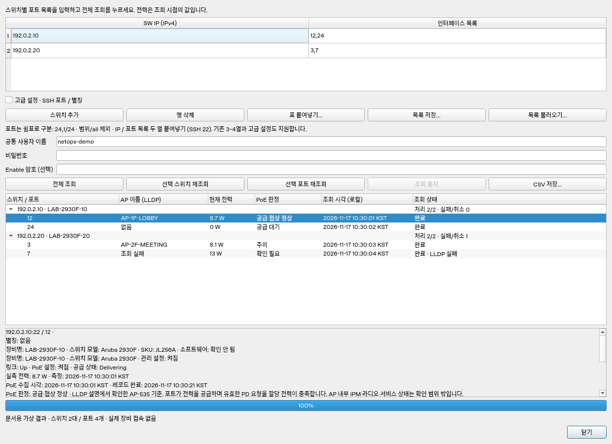

# 다중 스위치·포트 전력 조회

v0.3.0부터 메인 화면의 **포트 전력 조회…**에서 여러 스위치와 각 스위치의 여러
포트를 등록하고, 결과를 스위치별로 묶어서 확인할 수 있습니다. 장비 설정을 변경하지
않는 조회 기능입니다. 기존 [단일 포트 제어](PORT_CONTROL_KO.md)는 별도 창에서 사용합니다.



화면은 실제 앱에 문서용 가상 입력·결과를 넣어 렌더링한 예입니다. 실제 장비에 접속한
결과가 아니며, 각 포트의 전력과 오류를 어떻게 구분하는지 보여 줍니다.

## 1. 대상 입력

스위치 한 대를 입력 표의 한 행에 등록합니다. 인터페이스 목록은 쉼표로 구분합니다.

| SW IP | SSH 포트 | 인터페이스 목록 | 이름(선택) |
|---|---:|---|---|
| 192.0.2.10 | 22 | 12,24 | 점검 A |
| 192.0.2.20 | 22 | 3,7,10 | 점검 B |
| 192.0.2.30 | 2222 | 1/2,1/15,1/24 | VSF 예시 |

이 표는 문서용 가상 주소입니다. 각 행에 등록한 포트만 해당 스위치에서 조회합니다.
같은 IP라도 SSH 포트가 다르면 별도 접속 대상으로 구분합니다. 같은 접속 대상의
중복 행은 포트 목록을 합치고 중복 포트는 한 번만 조회합니다. 동일 대상에 서로 다른
이름을 입력했다면 이름을 정리한 뒤 다시 등록하십시오.

- **스위치 추가 / 행 삭제:** 직접 입력 목록을 편집합니다.
- **엑셀 붙여넣기:** IP, SSH 포트, 인터페이스 목록, 선택적 이름 순서로 복사합니다.
  탭으로 구분한 표 또는 CSV를 지원하며, CSV의 쉼표가 포함된 포트 목록은 큰따옴표로
  감쌉니다. 등록 전에 전체 내용을 검증하므로 오류가 있는 일부 행만 적용하지 않습니다.
- 포트는 `24`, VSF `1/24` 같은 실제 식별자를 사용합니다. `1-24`, `all`, `1/1/24`나
  임의 CLI 문장은 허용하지 않습니다. 입력 형식 통과 후에도 실제 장비의 포트 목록과
  모델을 확인합니다.

CSV 붙여넣기 예시:

```csv
ip,ssh_port,interfaces,label
192.0.2.10,22,"12,24",점검 A
192.0.2.20,22,"3,7,10",점검 B
```

공통 계정·암호와 필요한 경우 Enable 암호를 입력합니다. 기존 SSH 지문 확인 절차와
관리자 EXEC 준비를 사용하므로 조직에서 허용된 해당 명령 실행 권한이 필요합니다.

## 2. 조회와 결과

**전체 조회**를 누르면 최대 3대의 스위치를 동시에 처리하고, 같은 스위치의 포트는
한 SSH 연결에서 순서대로 조회합니다. 한 화면에 같이 표시되더라도 측정 시각은
포트마다 다르므로 각 행의 시각을 함께 확인하십시오.

결과의 상위 묶음은 `IP:SSH 포트`이며 하위 행이 인터페이스입니다. 묶음을 접고
펼칠 수 있습니다. 장비명은 조회 결과에서 확인한 값이며 장비를 구분하는 키가 아닙니다.

| 표시 | 해석 |
|---|---|
| 포트 관리 설정 | 인터페이스 사용 설정이며 물리 링크와 구분 |
| 물리 링크 | 현재 조회된 Up/Down |
| PoE 설정 | 해당 포트의 전원 공급 기능 사용 설정 |
| 공급 상태 | 전원 공급 중, 연결 기기 탐색 중, 오류 등 장비 응답 |
| 소비 전력(W) | 장비가 보고한 실제 공급 전력; 예약·할당 상한과 구분 |
| 조회 시각 | 해당 행의 측정 시각; 화면은 PC의 로컬 시각 |
| 확인 불가 / 미지원 / 실패 | 값을 얻지 못한 이유; 실제 0 W와 구분 |

PoE가 꺼져 있어 장비가 전력값을 생략하면 `0 W`로 추정하지 않습니다. 전력 공급은
AP 부팅·컨트롤러 등록·무선 서비스 정상 여부를 보장하지 않습니다.

스위치 접속 실패는 해당 묶음, 포트 조회 실패는 해당 행에 표시하며 다른 스위치의
결과는 유지합니다. 전송 오류로 연결 상태가 불확실해지면 같은 세션을 계속 쓰거나
숨겨진 재접속을 하지 않고 남은 포트의 실패를 표시합니다.

## 3. 재조회와 중지

- 묶음을 선택해 **선택 스위치 재조회**, 포트 행을 선택해 **선택 포트 재조회**를 합니다.
- 재조회하는 행의 이전 전력값은 대기로 바꾸고 새 결과로 대체합니다. 다른 대상의
  결과는 기존 조회 시각과 함께 남습니다.
- 입력 대상을 편집하면 이전 결과를 지웁니다. 결과가 다른 입력 대상으로 오인되지
  않도록 현재 목록을 확인한 다음 조회합니다.
- **조회 중지**는 새 명령과 접속 대상 시작을 중단합니다. 이미 진행 중인 제한된 SSH
  작업이 반환한 뒤 연결을 정리하므로 즉시 모든 소켓이 종료되는 방식은 아닙니다.
- 작업 중 창이나 부모 창을 닫으면 중지를 요청하고 실행 중인 작업을 정리한 뒤 닫습니다.
- 백업·포트 제어와 동시에 실행하지 않습니다. 조회 화면에는 전원 변경 명령이 없습니다.

## 4. 조회 대상 목록 저장·불러오기

**목록 저장**으로 JSON 파일을 만들고 **목록 불러오기**로 재사용합니다. 현재 입력이
있으면 교체를 확인합니다. 불러오기는 대상만 채우며 장비에 자동 접속하지 않습니다.

저장 항목은 IP, SSH 포트, 인터페이스 목록, 표시 이름입니다. 계정·암호·Enable 암호와
조회 결과는 저장하지 않습니다. 목록에는 내부 장비 주소가 있으므로 업무 자료로
관리하십시오. 다른 형식, 알 수 없는 필드, 중복 JSON 키, 잘못된 버전·타입은 거부합니다.
저장 실패 시 기존 파일은 유지합니다.

## 5. CSV 결과 저장

완료된 결과를 **CSV 저장**으로 내보냅니다. 포트 한 개가 한 행이고 IP와 SSH 포트,
인터페이스, 장비명, 상태, 실제 W, 측정 시각과 오류 정보를 함께 기록합니다.

- UTF-8 BOM으로 저장하여 Excel에서 한글을 읽을 수 있습니다.
- 실제 0 W는 0, 확인되지 않은 W는 빈 셀입니다. 상태/오류 열과 함께 읽습니다.
- 파일의 시각은 UTC ISO 8601입니다. 화면의 PC 로컬 시각과 시간대가 다를 수 있습니다.
- 이름 등 문자열이 스프레드시트 수식으로 실행되지 않도록 보호하여 저장합니다.
- CSV는 측정 결과이며 대상 목록 JSON과는 다른 파일입니다.

## 범위와 한계

등록 한계는 접속 대상 100개, 대상당 인터페이스 384개, 전체 2,000개입니다. 이는
앱의 작업 규모 제한이며 실제 장비의 포트 수를 뜻하지 않습니다. 붙여넣기는 100,000자,
목록 파일은 1 MiB, 표시 이름은 80자로 제한합니다. 연결 제한은 15초, 개별 명령은
20초이고 자동 재시도하지 않습니다.

이 버전은 수동 조회입니다. 주기적 측정, 누적 Wh/kWh, LLDP 추가 수집, 스위치별
다른 계정, 암호 저장, 일괄 전원 제어는 포함하지 않습니다. 실제 스위치 운영 환경은
별도 현장 검증 범위입니다.

공식 근거: [ArubaOS-S 16.11 특정 포트 PoE 상태](https://arubanetworking.hpe.com/techdocs/AOS-S/16.11/MCG/WC/content/common%20files/vie-poe-sta-spe-por.htm).
