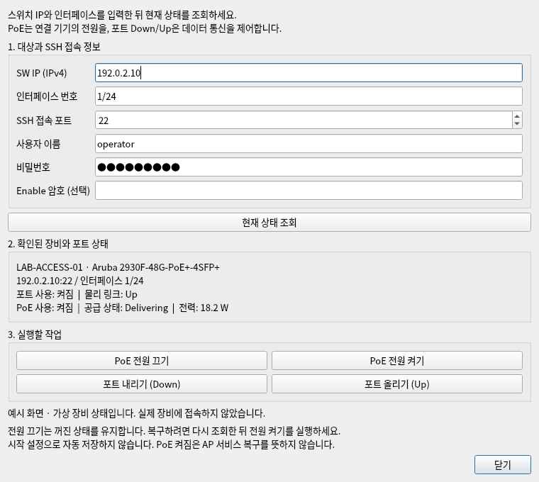

# SW IP와 인터페이스로 전원·포트 제어

이 기능은 **v0.2.0 사전릴리즈부터 제공**하며 기존 v0.1.8 배포 ZIP에는 없습니다.
GitHub Releases에서 `Aruba2930FConfigBackup_v0.2.0_windows_x64.zip`을 사용하십시오.

아래는 실제 앱 위젯에 문서용 가상 장비 상태를 넣은 예시 화면입니다.
Linux Qt 렌더링이므로 Windows의 창 테두리·글꼴은 다를 수 있으며 실제 장비 수집 결과가 아닙니다.



## 어떤 버튼을 사용하는가

| 목적 | 버튼 | 확인하는 설정 |
|---|---|---|
| PoE로 연결된 AP 등의 전원을 끄기 | PoE 전원 끄기 | `Power Enable : No` |
| PoE 전원 공급 기능을 켜기 | PoE 전원 켜기 | `Power Enable : Yes` |
| 포트의 데이터 통신을 내리기 | 포트 내리기 (Down) | `Enabled : No` |
| 포트의 데이터 통신을 올리기 | 포트 올리기 (Up) | `Enabled : Yes` |

포트 Down과 PoE 전원 차단은 별개입니다. PoE 공급 대상이 아닌 기기나 별도 전원을
사용하는 기기는 PoE를 꺼도 전원이 유지될 수 있습니다. 관리 경로나 상단 연결 포트를
내리면 SSH 연결도 끊길 수 있으므로 실제 배선과 대상 장비를 먼저 확인하십시오.

## 사용 순서

1. 메인 화면에서 **포트 제어…**를 엽니다. 백업 대상이 한 대이면 그 IP와 접속 정보가
   복사되며 여러 대이면 SW IP를 직접 입력합니다.
2. **SW IP**, **인터페이스 번호**, **SSH 접속 포트**, **계정/암호**를 확인합니다.
   `SSH 접속 포트 22`와 `인터페이스 24`는 다른 항목입니다.
3. 인터페이스는 일반 장비 `24`, VSF `1/24` 같은 실제 식별자를 입력합니다.
   `1/1/24`, `1-24`, `all`, 쉼표로 여러 포트를 입력하는 방식은 허용하지 않습니다.
4. **현재 상태 조회**를 누릅니다. 처음 연결하는 장비는 SSH 지문을 확인합니다.
5. 확인된 장비명, SW IP, 인터페이스와 상태를 읽고 실행할 버튼을 누릅니다.
6. 확인 창에 표시된 `192.0.2.10:22 / 24` 같은 대상 문자열을 그대로 입력하고 실행합니다.
7. 결과를 확인합니다. 다음 작업은 현재 상태를 다시 조회한 뒤 실행합니다.

전원 끄기는 꺼진 상태를 유지합니다. 전원 재공급은 다시 조회한 뒤 **PoE 전원 켜기**로
진행합니다. 자동으로 일정 시간 후 켜는 기능은 이번 버전에 포함되지 않습니다.

## 상태를 읽는 방법

| 화면 | 뜻 |
|---|---|
| 포트 사용: 켜짐 | 관리 설정상 포트가 활성화됨 |
| 물리 링크: Down | 실제 링크가 내려감. 사용 설정이 꺼졌다는 뜻은 아님 |
| PoE 사용: 켜짐 | PoE 전원 공급 기능이 활성화됨 |
| 공급 상태: Searching | 전원을 공급할 기기를 탐색 중 |
| 공급 상태: Delivering | 기기에 전원을 공급 중 |
| PoE 확인 불가 / 미지원 | PoE 제어에 필요한 상태를 확인하지 못하여 해당 버튼 비활성화 |

PoE 켜짐 확인은 AP 부팅, 컨트롤러 재등록, 무선 서비스 복구를 의미하지 않습니다.
`Detection Status=Disabled`도 전력 부족 등에 의해 발생할 수 있으므로
설정상 켜짐/꺼짐은 `Power Enable`로 판단합니다.

PoE 출력 형식에 따라 공급 상태는 `Detection Status` 또는 `PoE Port Status`,
소비 전력은 `Power` 또는 `PD Power Draw`에서 읽습니다. `PSE Reserved Power` 등
예약·할당 전력은 소비 전력으로 표시하지 않습니다. 각 형식의 대상 포트와 상태 필드가
일치해야 하며 중복·혼합·불명확한 출력에서는 변경을 중단합니다.
두 형식의 근거는 [AOS-S 16.11 공식 관리 안내서의 PoE 출력 예제](https://arubanetworking.hpe.com/techdocs/AOS-Switch/16.11/Aruba%202930%20M%26F%20Management%20and%20Configuration%20Guide%20for%20AOS-S%2016.11.pdf#page=104)입니다.
출력 형식 지원이 2930F 이외 장비에 대한 지원 확대를 뜻하지는 않습니다.

## 실행 결과와 복구

- **설정 확인:** 요청한 관리 설정을 재조회하여 확인한 결과입니다. 실제 링크/전원 공급은 별도 표시합니다.
- **이미 해당 상태:** 상태 변경 명령을 보내지 않습니다.
- **결과 확인 불가:** 변경 명령이 전달됐을 수 있습니다. 자동 재전송하지 않으며, 다시 조회해 실제 상태를 확인합니다.
- **대상/설정 변경 또는 조회 만료:** 변경 전 중단합니다. 조회 결과는 120초 동안만 유효합니다.

같은 창에서 여러 작업을 동시에 실행할 수 없고 백업 중에는 제어 창을 열 수 없습니다.
실행 중 창 닫기는 결과 확인이 끝날 때까지 기다립니다. 프로세스 강제 종료나 PC
전원 종료 뒤 자동 복구를 보장하지 않으므로 실행 결과를 확인한 뒤 종료하십시오.

## 저장과 명령 범위

포트 제어는 running-config를 변경하고 `write memory`는 실행하지 않습니다.
스위치 재부팅 뒤 상태는 저장된 startup-config에 따라 달라집니다. 다른 운영자가
전체 설정을 저장하면 이 변경도 포함될 수 있습니다.

별도 작업 이력 JSONL에는 시각, 대상 IP/포트, 장비명, 선택한 동작, 전후 상태와 결과를
기록합니다. 화면에 실제 이력 파일 경로가 표시됩니다. 이 파일에는 장비 식별 정보가
포함되므로 공개 저장소나 공개 이슈에 원문을 올리지 마십시오. 계정 암호와 Enable
암호, 전체 장비 설정 및 임의 CLI 출력은 저장하지 않습니다.

변경 명령은 다음 네 가지로 제한됩니다. 백업 서비스는 계속 설정 모드에 진입하지 않습니다.

```text
no interface <PORT> power-over-ethernet
interface <PORT> power-over-ethernet
interface <PORT> disable
interface <PORT> enable
```

## 공식 명령 근거

- [2930F/2930M AOS-S 16.11 관리 가이드](https://arubanetworking.hpe.com/techdocs/AOS-Switch/16.11/Aruba%202930%20M%26F%20Management%20and%20Configuration%20Guide%20for%20AOS-S%2016.11.pdf)
- [포트 상태와 설정 조회](https://arubanetworking.hpe.com/techdocs/AOS-S/16.11/MCG/WC/content/common%20files/vie-por-sta-cnf-cli.htm)
- [포트 활성화·비활성화](https://arubanetworking.hpe.com/techdocs/AOS-S/16.11/MCG/WC/content/common%20files/ena-dis-por-cnf-por-mod-cli.htm)
- [특정 포트 PoE 상태](https://arubanetworking.hpe.com/techdocs/AOS-S/16.11/MCG/WC/content/common%20files/vie-poe-sta-spe-por.htm)

장비 펌웨어/출력 차이를 추측으로 처리하지 않습니다. 필요한 상태를 명확히 읽을 수
없으면 변경을 중단하며, 실제 운영 장비 호환성은 사용자 현장 검증 대상입니다.

포트 제어는 `edge-lab#`와 같은 일반적인 관리자 EXEC 프롬프트와
`edge-lab(config)#` 설정 프롬프트를 지원합니다. 호스트명에는 영문·숫자와
`_`, `.`, `+`, `-`를 사용할 수 있습니다. 공백·괄호 래퍼 등 다른 형식의 프롬프트나
인식할 수 없는 상태 출력은 변경 전에 거부합니다. 백업의 프롬프트 지원 범위와는 다릅니다.
